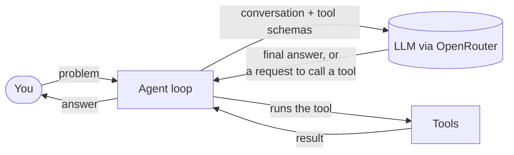

# IT Support Agent

An autonomous IT support agent. Describe a server problem in plain English, and the agent checks
the server's health, reads its logs, decides what to do, and does it: restarts the service, escalates
to a human engineer, or tells you everything is fine.

It is built from scratch in Python, without an agent framework: a small agent loop, tools written as
plain functions, and an LLM (`gpt-4.1-mini` by default) reached through [OpenRouter](https://openrouter.ai).

```text
$ uv run it-support-agent "search-index-09 has a problem, please handle it"
-> TOOL: Escalating to human...
The server search-index-09 is experiencing dependency failure with connection refused errors to
the elastic-cluster-main search engine, although its CPU and memory usage are low. I did not
restart the service due to the dependency issue and have escalated this to an engineer with
ticket ID INC-F8B41C5D.
```

> **Note:** server metrics and logs are **mocked**. No tool touches a real server or ticketing system yet.

## How it works



1. The agent sends your message, the conversation so far, and a description of every tool to the model.
2. The model either answers, or asks for one or more tools to be called.
3. The agent runs those tools and sends the results back to the model.
4. Steps 2–3 repeat until the model answers, up to a step limit (10 by default).

The model never runs code itself; it can only ask. All tool execution happens in this project's code.

For the full picture, with diagrams of every component, see **[docs/architecture.md](docs/architecture.md)**.

New to Python? Start with **[docs/beginners-guide.md](docs/beginners-guide.md)**. It covers which
files to read first and how a question flows through the code, and it explains each Python feature
the project uses.

## Tools

| Tool | What it does |
|---|---|
| `get_server_health(server_id)` | Returns a server's CPU and memory usage and status |
| `fetch_recent_logs(server_id, lines=5)` | Returns the last N log lines from a server |
| `restart_service(server_id)` | Restarts the service on a server |
| `escalate_to_engineer(summary)` | Creates a support ticket for a human engineer |

The system prompt gives the agent decision rules: diagnose first, restart for high CPU or a memory
leak, escalate for dependency or network failures (never restart those), and do nothing for healthy
servers.

### Mock servers to try

| Server | Problem | Expected action |
|---|---|---|
| `payment-server-01` | CPU at 98%, thread pool exhausted | Restart |
| `db-node-02` | None | No action |
| `auth-service-03` | Memory at 95%, memory leak | Restart |
| `search-index-09` | Search engine dependency down | Escalate |
| `frontend-node-04` | None | No action |

## Getting started

### Prerequisites

- [uv](https://docs.astral.sh/uv/) (installs Python 3.13 for you if needed)
- An [OpenRouter API key](https://openrouter.ai/keys)

### Install

```sh
git clone <this-repo>
cd it-support-agent
uv sync
cp .env.example .env
```

Then open `.env` and set `OPENROUTER_API_KEY`. `.env` is git-ignored, so your key stays out of the
repository.

### Run

```sh
# Ask one question and exit
uv run it-support-agent "payment-server-01 is slow, please handle it"

# Interactive chat (type 'reset' to clear history, 'exit' to quit)
uv run it-support-agent

# Same thing, run as a module
uv run python -m it_support_agent "is db-node-02 ok?"

# See each tool call the agent makes
LOG_LEVEL=INFO uv run it-support-agent "auth-service-03 keeps crashing"
```

## Configuration

Settings are read from `.env` (or from your shell environment, which takes priority).

| Variable | Default | Description |
|---|---|---|
| `OPENROUTER_API_KEY` | *required* | Your OpenRouter API key |
| `OPENROUTER_MODEL` | `openai/gpt-4.1-mini` | Any [OpenRouter model ID](https://openrouter.ai/models) |
| `OPENROUTER_BASE_URL` | `https://openrouter.ai/api/v1` | API endpoint (any OpenAI-compatible API works) |
| `AGENT_MAX_STEPS` | `10` | Maximum model calls per question |
| `LOG_LEVEL` | `WARNING` | `INFO` shows tool calls, `DEBUG` also shows tool results |

## Project structure

```
src/it_support_agent/
├── cli.py               # entry point: one-shot or interactive
├── core/                # settings (.env), logging, error types
├── llm/client.py        # OpenRouter client
├── tools/
│   ├── decorator.py     # @tool: turns a function into a tool + JSON schema
│   ├── registry.py      # holds tools, builds schemas, runs tool calls safely
│   └── builtin/         # the tools: servers.py, tickets.py
└── agent/
    ├── loop.py          # the agent loop
    └── prompts.py       # system prompt with the decision rules
tests/unit/              # mirrors src/; uses a fake LLM, no network
docs/architecture.md     # detailed design with diagrams
docs/beginners-guide.md  # where to start reading, for Python beginners
```

## Adding a tool

A tool is a normal function with type hints and a docstring, decorated with `@tool`:

```python
from typing import Annotated

from pydantic import Field

from it_support_agent.core.exceptions import ToolError
from it_support_agent.tools import tool


@tool
def check_port(
    host: Annotated[str, Field(description="Hostname or IP address.")],
    port: Annotated[int, Field(description="TCP port to check.")] = 443,
) -> dict:
    """Checks whether a TCP port on a host is accepting connections."""
    if not 0 < port < 65536:
        raise ToolError("port must be between 1 and 65535")
    ...
```

Then add it to `BUILTIN_TOOLS` in `src/it_support_agent/tools/builtin/__init__.py`. That's all:

- the **function name** becomes the tool name,
- the **docstring** becomes the description the model reads (say what it does *and* when to use it),
- the **type hints** become the JSON schema, and the model's arguments are validated against them,
- a **`ToolError`** is sent back to the model as `{"error": "..."}` so it can recover.

If the model needs to know *when* to use the new tool, add a rule to `agent/prompts.py`.

## Development

```sh
uv run pytest                                 # run tests (no network, under a second)
uv run ruff check . && uv run ruff format .   # lint and format
```

Unit tests use a fake LLM client, so they check the plumbing (schemas, tool calls, the loop), not
the model's decisions. To check decisions, run the five mock scenarios live:

```sh
for s in payment-server-01 db-node-02 auth-service-03 search-index-09 frontend-node-04; do
  LOG_LEVEL=INFO uv run it-support-agent "$s has a problem, please handle it"
done
```

## Limitations

- Server metrics, logs, restarts and tickets are all mocked.
- The agent restarts servers without asking for confirmation.
- Network and rate-limit errors from the API are not retried.
- If the step limit is reached, the run ends with an error instead of a best-effort answer.

See [docs/architecture.md](docs/architecture.md#13-design-decisions-and-current-limitations) for
the full list and the reasoning behind the design.
