# Architecture

This document explains how the IT support agent works: the pieces it is made of, how a request
flows through them, and how to extend it. Diagrams are written in [Mermaid](https://mermaid.js.org/)
and render on GitHub and in VS Code (with a Mermaid preview extension).

## Contents

1. [What the agent does](#1-what-the-agent-does)
2. [Project layout](#2-project-layout)
3. [Components](#3-components)
4. [Lifecycle of a request](#4-lifecycle-of-a-request)
5. [The agent loop](#5-the-agent-loop)
6. [Tools](#6-tools)
7. [The tool registry](#7-the-tool-registry)
8. [The system prompt and decision rules](#8-the-system-prompt-and-decision-rules)
9. [Configuration](#9-configuration)
10. [Errors](#10-errors)
11. [Testing](#11-testing)
12. [Extending the agent](#12-extending-the-agent)
13. [Design decisions and current limitations](#13-design-decisions-and-current-limitations)

---

## 1. What the agent does

The user describes a problem in plain English ("payment-server-01 is slow, fix it"). The agent
uses a large language model (LLM) to decide what to do, and a set of **tools** (plain Python
functions) to actually do it: check server health, read logs, restart a service, or escalate to a
human engineer. It repeats "think → act → observe" until it has an answer.

The key idea: **the LLM never runs code.** It can only *ask* for a tool to be called. Our code runs
the tool and sends the result back. The loop that does this lives entirely in our code.

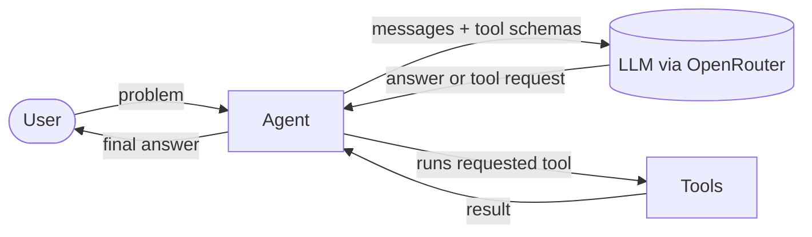

---

## 2. Project layout

```
it-support-agent/
├── pyproject.toml            # dependencies, entry point, pytest + ruff config
├── .env / .env.example       # secrets and settings (.env is git-ignored)
├── docs/architecture.md      # this file
├── src/it_support_agent/
│   ├── cli.py                # entry point: builds everything, runs one-shot or REPL
│   ├── __main__.py           # lets you run `python -m it_support_agent`
│   ├── core/
│   │   ├── config.py         # Settings, loaded from .env
│   │   ├── logging.py        # logging setup
│   │   └── exceptions.py     # AgentError, MaxStepsExceededError, ToolError
│   ├── llm/
│   │   └── client.py         # OpenRouter client (OpenAI-compatible)
│   ├── tools/
│   │   ├── decorator.py      # @tool: turns a function into a Tool with a JSON schema
│   │   ├── registry.py       # ToolRegistry: holds tools, builds schemas, runs calls
│   │   └── builtin/
│   │       ├── __init__.py   # BUILTIN_TOOLS: the list of tools the agent gets
│   │       ├── servers.py    # get_server_health, fetch_recent_logs, restart_service
│   │       └── tickets.py    # escalate_to_engineer
│   └── agent/
│       ├── loop.py           # Agent: the think → act → observe loop
│       └── prompts.py        # SYSTEM_PROMPT with the decision rules
└── tests/unit/               # mirrors src/; uses a fake LLM client, no network
```

The project uses the **src layout**: code lives under `src/` and is installed into the virtual
environment as a package. There is no `main.py`. `pyproject.toml` declares the command:

```toml
[project.scripts]
it-support-agent = "it_support_agent.cli:main"
```

`uv sync` installs a small launcher at `.venv/bin/it-support-agent` that imports and calls
`cli.main()`. That is what `uv run it-support-agent` runs.

---

## 3. Components

Each layer only depends on the layers below it. `core` depends on nothing in the project; `cli`
is the only module that knows about everything and wires it together.

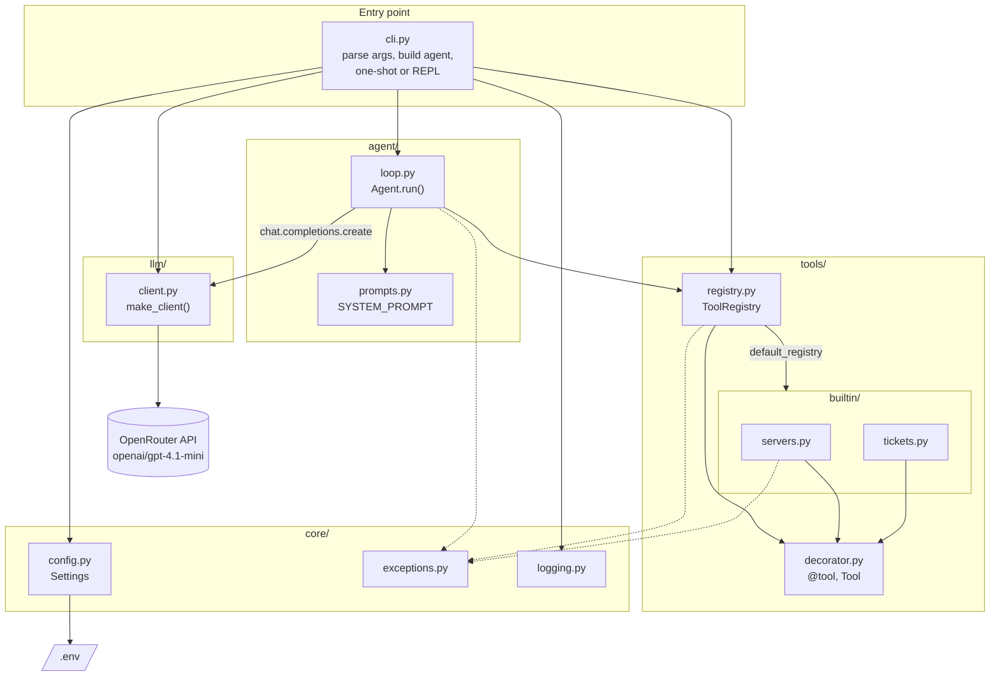

| Module | Responsibility | Knows about |
|---|---|---|
| `core/config.py` | Read settings from `.env` into a frozen `Settings` object | nothing else in the project |
| `core/exceptions.py` | Error types shared by all layers | nothing |
| `llm/client.py` | Build an `OpenAI` client pointed at OpenRouter | `Settings` |
| `tools/decorator.py` | Turn a function into a `Tool` (name, description, schema, function) | pydantic |
| `tools/registry.py` | Store tools, return their schemas, run a tool call safely | `Tool`, `ToolError` |
| `tools/builtin/*` | The actual tools | `@tool`, `ToolError` |
| `agent/loop.py` | Talk to the model and dispatch tool calls until there is an answer | client, registry, prompt |
| `cli.py` | Wire everything together and handle user input | everything |

Because the `Agent` receives its client and registry as arguments (instead of creating them
itself), tests can pass in a fake client and a registry with test tools. This is called
**dependency injection**.

---

## 4. Lifecycle of a request

What happens when you run:

```sh
uv run it-support-agent "search-index-09 is broken, sort it out"
```

### Startup

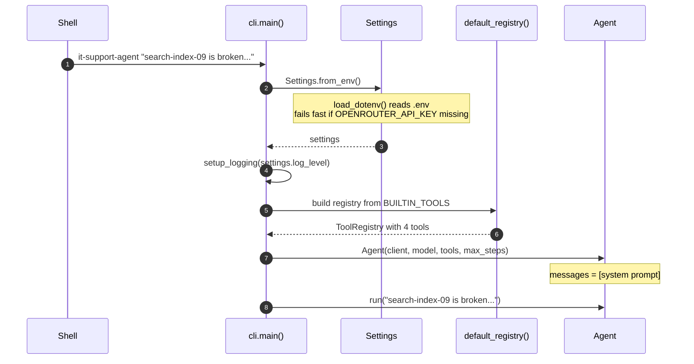

### One run, step by step

This is a real run of the `search-index-09` scenario (dependency failure → escalate).

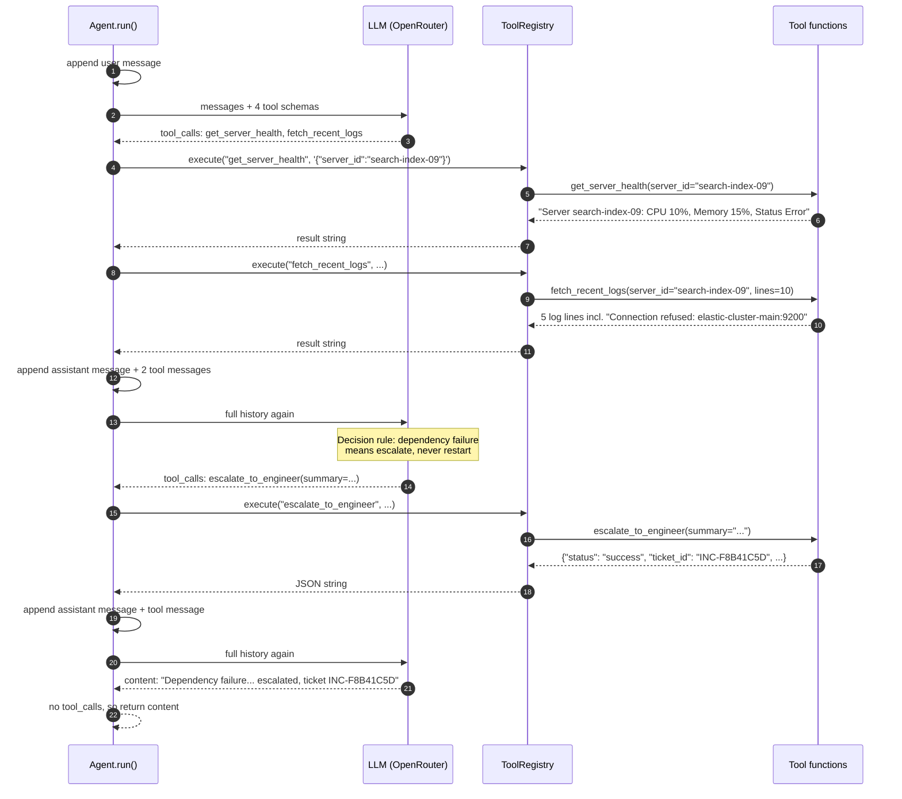

### What the message history looks like

The model has no memory between requests. Every call sends the **whole conversation** so far.
After the run above, `agent.messages` contains:

| # | role | content |
|---|---|---|
| 1 | `system` | the system prompt with decision rules |
| 2 | `user` | "search-index-09 is broken, sort it out" |
| 3 | `assistant` | *(no text)* `tool_calls`: `get_server_health`, `fetch_recent_logs` |
| 4 | `tool` | `tool_call_id=call_a` → "Server search-index-09: CPU 10%, …" |
| 5 | `tool` | `tool_call_id=call_b` → the log lines |
| 6 | `assistant` | `tool_calls`: `escalate_to_engineer` |
| 7 | `tool` | `tool_call_id=call_c` → `{"status": "success", "ticket_id": …}` |
| 8 | `assistant` | the final answer |

Each `tool` message carries the `tool_call_id` of the request it answers. That is how the model
matches results to requests when it asked for several tools at once.

---

## 5. The agent loop

`Agent.run()` in `agent/loop.py` is the heart of the system.

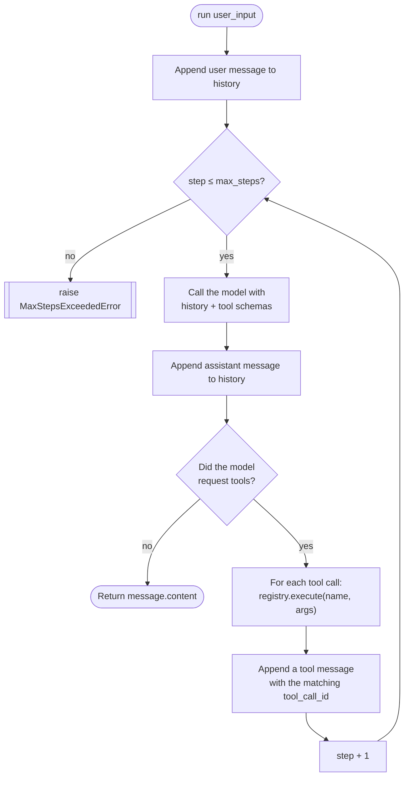

**Why there is a `max_steps` limit.** Each step is a separate, paid API request that our code
starts. The model does not know how many steps it has taken and cannot stop itself. Without a
limit, a model that keeps asking for tools (for example, retrying a failing tool forever) would
loop forever. `AGENT_MAX_STEPS` (default 10) caps it.

**One step can contain several tool calls.** Modern models can ask for multiple tools in one
response (above, health and logs together). They are run one after another, and each result is
appended before the next model call.

**History is kept between turns.** In interactive mode, a follow-up question ("and what about
db-node-02?") is appended to the same history, so the model has context. Typing `reset` calls
`agent.reset()`, which clears everything except the system prompt.

---

## 6. Tools

### Writing a tool

A tool is a normal Python function with type hints and a docstring, decorated with `@tool`:

```python
from typing import Annotated
from pydantic import Field
from it_support_agent.tools import tool

ServerId = Annotated[str, Field(description="The ID of the server, e.g., 'payment-server-01'.")]

@tool
def fetch_recent_logs(
    server_id: ServerId,
    lines: Annotated[int, Field(description="Number of log lines to fetch.")] = 5,
) -> str:
    """Retrieves the most recent log entries from a server to diagnose errors."""
    ...
```

| Part of the function | Becomes |
|---|---|
| Function name `fetch_recent_logs` | Tool name the model calls |
| Docstring | Tool description: tells the model **what** it does and **when** to use it |
| Parameter `server_id: ServerId` | Required string property with a description |
| Parameter `lines: ... = 5` | Optional integer property, default 5 |
| `Annotated[..., Field(description=...)]` | The parameter's description in the schema |

### How `@tool` builds the schema

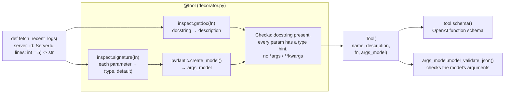

The pydantic `args_model` does two jobs from one definition, so they can never disagree:

1. **Describe** the inputs to the model: `args_model.model_json_schema()` produces the
   `parameters` section of the schema.
2. **Check** what the model sends back: `args_model.model_validate_json(raw_args)` parses the
   model's JSON arguments, rejects wrong types, and fills in defaults.

The generated schema for `fetch_recent_logs`, which is exactly what the model receives:

```json
{
  "type": "function",
  "function": {
    "name": "fetch_recent_logs",
    "description": "Retrieves the most recent log entries from a server to diagnose errors.",
    "parameters": {
      "type": "object",
      "properties": {
        "server_id": {"type": "string", "description": "The ID of the server, e.g., 'payment-server-01'."},
        "lines": {"type": "integer", "description": "Number of log lines to fetch.", "default": 5}
      },
      "required": ["server_id"]
    }
  }
}
```

(pydantic also adds `title` fields, which the model ignores.)

Because the schema is generated, there is no hand-written `tools_schema` list to keep in sync.
Renaming a parameter in the function updates the schema automatically.

The decorated name is still callable like the original function: `fetch_recent_logs("db-node-02")`
works, which keeps tools easy to test and reuse.

### Return values

| Tool returns | The model sees |
|---|---|
| a `str` | that string, unchanged (log text, a sentence, or a JSON string you built) |
| anything else (`dict`, `list`, number) | the value encoded once with `json.dumps` |
| raises `ToolError("msg")` | `{"error": "msg"}` |

Do not call `json.dumps` on a dict *and* return it expecting the registry to handle it; a string is
passed through as-is. Either return the dict, or return your own JSON string (as `restart_service`
and `escalate_to_engineer` do, because their task spec asks for a JSON string).

### Built-in tools

All data is **mocked** for now (`MOCK_SERVER_METRICS`, `MOCK_SERVER_LOGS`); nothing touches a real
server.

| Tool | Module | Arguments | Returns | Side effect |
|---|---|---|---|---|
| `get_server_health` | `servers.py` | `server_id` | `"Server X: CPU 98%, Memory 40%, Status Warning"` | none |
| `fetch_recent_logs` | `servers.py` | `server_id`, `lines=5` | last N log lines, newline-separated | none |
| `restart_service` | `servers.py` | `server_id` | `{"status": "success", "message": "Server X restarted successfully"}` | prints `-> TOOL: Restarting service...` |
| `escalate_to_engineer` | `tickets.py` | `summary` | `{"status": "success", "ticket_id": "INC-…", "message": …}` | prints `-> TOOL: Escalating to human...` |

Validation done inside the tools (returned to the model as errors):

- Unknown `server_id` → `Unknown server 'x'. Known servers: …`, so the model can correct a typo.
- `lines < 1` → `lines must be at least 1` (in Python, `logs[-0:]` would silently return everything).
- Empty `summary` → `summary must not be empty`.

### Mock scenarios

| Server | CPU | Memory | Status | Logs say | Expected action |
|---|---|---|---|---|---|
| `payment-server-01` | 98% | 40% | Warning | thread pool exhausted, process hung | restart |
| `db-node-02` | 12% | 60% | Healthy | backups OK, health check OK | none |
| `auth-service-03` | 45% | 95% | Critical | `OutOfMemoryError`, memory leak | restart (or escalate) |
| `search-index-09` | 10% | 15% | Error | connection refused to `elastic-cluster-main:9200` | escalate, no restart |
| `frontend-node-04` | 25% | 30% | Healthy | all requests 200 OK | none |

---

## 7. The tool registry

`ToolRegistry` (in `tools/registry.py`) is a dictionary of tools by name with three jobs:

- `register(tool)`: add a tool; a duplicate name raises `ValueError` at startup.
- `schemas()`: the list of schemas sent to the model on every request.
- `execute(name, raw_args)`: run one tool call and return the text for the model.

`default_registry()` builds a registry from `BUILTIN_TOOLS` in `tools/builtin/__init__.py`.

### `execute()`: a tool call never crashes the agent

Every failure is turned into an `{"error": ...}` message and sent back to the model, which can
then retry with fixed arguments, pick another tool, or explain the problem to the user.

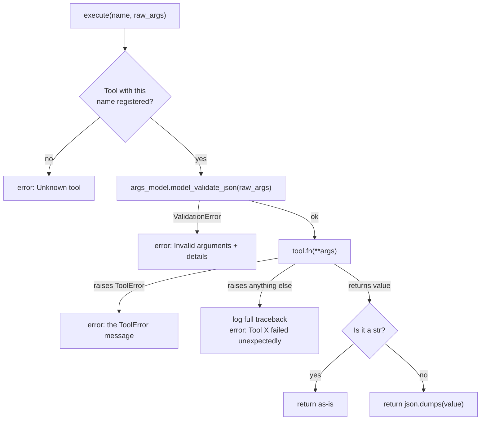

Note the difference between the two kinds of tool exceptions:

- **`ToolError`** is an *expected* failure with a message meant for the model ("Unknown server").
  The message is passed through.
- **Any other exception** is a *bug*. The traceback is logged for developers, and the model only
  gets a generic message, so internal details do not leak into the conversation.

---

## 8. The system prompt and decision rules

Tool descriptions tell the model what each tool *can* do. The system prompt in `agent/prompts.py`
tells it what it *should* do. Without it, the model restarted `search-index-09` even though its
problem was a dependency that a restart cannot fix.

The prompt asks the model to diagnose first (health **and** logs), then apply these rules:

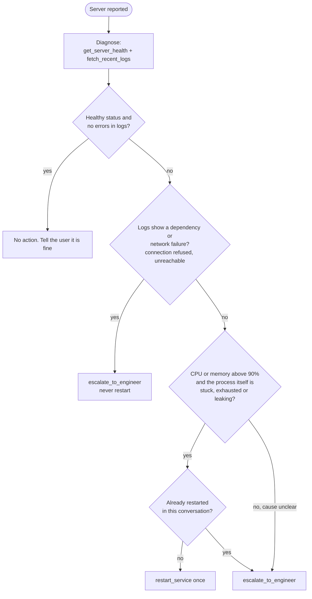

The rules are written in general terms ("dependency failure", "above 90%"), not per server, so
they apply to servers the agent has never seen. The prompt also tells the model what a good
escalation summary contains (server, metrics, key log lines, what was tried) and how to format the
final answer.

---

## 9. Configuration

Settings are read from the environment by `Settings.from_env()` in `core/config.py`.
`load_dotenv()` loads `.env` first, so values in `.env` are used unless the variable is already set
in the shell.

| Variable | Default | Purpose |
|---|---|---|
| `OPENROUTER_API_KEY` | *(required)* | API key; startup fails with a clear message if missing |
| `OPENROUTER_BASE_URL` | `https://openrouter.ai/api/v1` | API endpoint |
| `OPENROUTER_MODEL` | `openai/gpt-4.1-mini` | Model to use (any OpenRouter model ID) |
| `AGENT_MAX_STEPS` | `10` | Maximum model calls per user turn |
| `LOG_LEVEL` | `WARNING` | Set to `INFO` to see each tool call, `DEBUG` to see tool results |

**Why OpenRouter works with the `openai` package.** OpenRouter exposes the same API as OpenAI, so
`llm/client.py` creates a normal `OpenAI` client with a different `base_url`. Switching providers
or models is a configuration change, not a code change.

`.env` is git-ignored and readable only by its owner. `.env.example` is committed as a template.

---

## 10. Errors

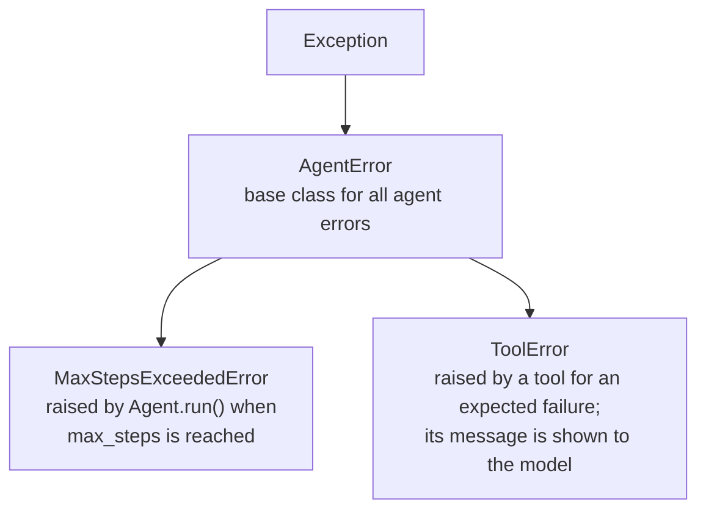

| Error | Raised by | Handled by | User sees |
|---|---|---|---|
| `RuntimeError` (missing API key) | `Settings.from_env()` | nobody: stops at startup | a clear message telling them to set the key |
| `ToolError` | a tool | `ToolRegistry.execute()` | nothing directly; the model gets `{"error": ...}` and reacts |
| any other exception in a tool | a tool (a bug) | `ToolRegistry.execute()` | nothing directly; traceback is logged |
| `MaxStepsExceededError` | `Agent.run()` | `cli.py` REPL | `error: No final answer after N steps` |
| API errors (network, auth, rate limit) | `openai` client | not handled yet | a Python traceback |

---

## 11. Testing

```sh
uv run pytest                                  # all tests, no network, < 1 second
uv run ruff check . && uv run ruff format .    # lint and format
```

Tests mirror the source layout under `tests/unit/`:

| Test file | What it covers |
|---|---|
| `tools/test_decorator.py` | schema built from type hints, defaults, `Annotated` descriptions; missing docstring and type hints rejected |
| `tools/test_registry.py` | string pass-through, JSON encoding, every error path, duplicate names, built-in tools registered |
| `tools/test_servers.py` | all five mock servers, log slicing, restart output, unknown servers, bad `lines` |
| `tools/test_tickets.py` | ticket JSON and ID format, unique IDs, printed message, empty summary |
| `agent/test_loop.py` | plain answer, tool call then answer, history across turns, `max_steps` |

### The fake LLM client

`tests/conftest.py` defines `FakeClient`, which replaces the OpenAI client in agent tests. It
returns a scripted list of replies in order and records every request, so tests are fast,
free, and give the same result every time.

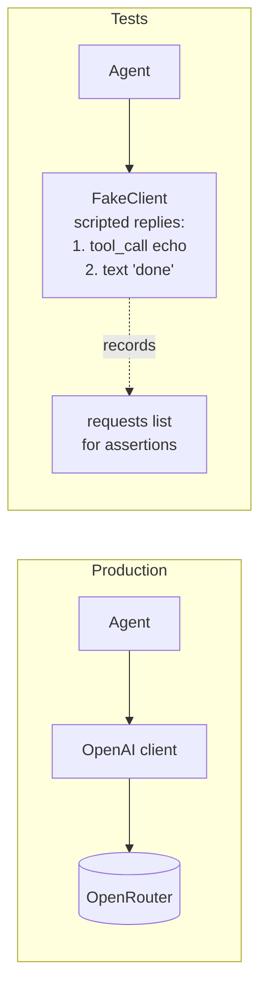

Agent tests use a test-only `echo` tool (also in `conftest.py`) so they do not depend on the
built-in tools.

**What the unit tests do not cover:** whether the model makes the *right decision*. That depends
on the prompt and the model, and can change between runs. It is checked by running the five
scenarios live:

```sh
for s in payment-server-01 db-node-02 auth-service-03 search-index-09 frontend-node-04; do
  LOG_LEVEL=INFO uv run it-support-agent "$s has a problem, please handle it"
done
```

---

## 12. Extending the agent

### Add a tool

1. Write a function with type hints and a docstring in a module under `tools/builtin/` (create a
   new module for a new area, for example `network.py`).
2. Decorate it with `@tool`. Use `Annotated[..., Field(description=...)]` for parameter
   descriptions, and raise `ToolError` for failures the model should see.
3. Add it to `BUILTIN_TOOLS` in `tools/builtin/__init__.py`.
4. Add tests under `tests/unit/tools/`.
5. If the model needs to know *when* to use it, add a rule to `agent/prompts.py`.

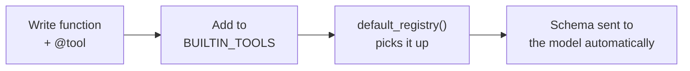

### Replace mock data with real systems

The tools are the only place that touch servers. Replacing `MOCK_SERVER_METRICS` with a call to a
monitoring API, or `restart_service` with a real restart, does not affect the loop, registry or
CLI. Tools that need configuration (credentials, URLs) can read it from `Settings`.

### Change the model or provider

Set `OPENROUTER_MODEL` in `.env`. For a non-OpenRouter, OpenAI-compatible API, change
`OPENROUTER_BASE_URL` and the key.

---

## 13. Design decisions and current limitations

### Decisions

| Decision | Why |
|---|---|
| Plain functions + `@tool` instead of a class per tool | Less boilerplate; tools so far are stateless. The function is the single source of truth for the schema. |
| Schemas generated, not hand-written | A hand-written list can drift out of sync with the functions. |
| Tool errors returned to the model, not raised | The model can recover (fix a typo, try another tool) instead of the whole run failing. |
| Our own loop instead of a framework | The loop is about 30 lines, easy to read and debug, and teaches how agents actually work. |
| Client and registry injected into `Agent` | Lets tests run with a fake client and no network. |
| OpenRouter through the `openai` package | One standard client, any model, switched by configuration. |

### Limitations

- **Mock data only.** No tool talks to a real server or ticketing system yet.
- **Restarts need no confirmation.** The agent restarts a server on its own. That is harmless with
  mock data, but a real system should ask for confirmation or enforce the "restart once" rule in
  code rather than relying on the prompt.
- **Decisions are not tested automatically.** Unit tests use a fake model; the live scenario check
  above is manual.
- **Hitting `max_steps` gives no answer.** The run raises an error instead of asking the model for
  a best-effort answer with what it has learned so far.
- **API errors are not handled.** A network or rate-limit error ends the run with a traceback; no
  retries.
- **Tools print to stdout.** The `-> TOOL: ...` messages come from the task spec; they mix with the
  agent's output and could move to logging later.
- **History grows without limit.** Long interactive sessions resend the whole conversation every
  step, which gets slower and more expensive. `reset` clears it.
- **Tool calls in one step run one after another**, not in parallel.
