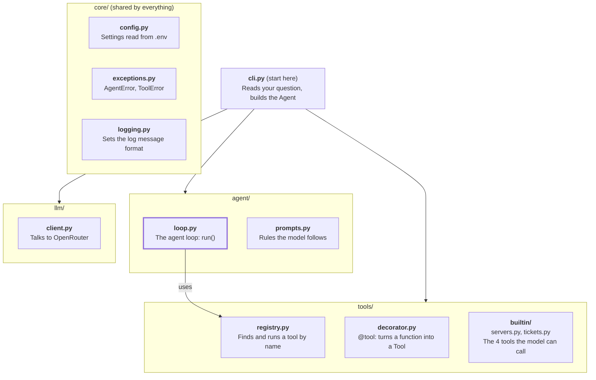
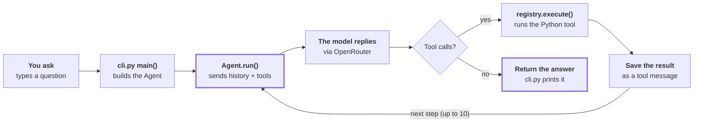

# IT Support Agent: A Beginner's Guide

A guided tour of this project for someone new to Python. It covers which files to read first, how
the pieces fit together, and the Python features the code uses.

For the full technical design, see [architecture.md](architecture.md).

## Contents

1. [What this project is](#what-this-project-is)
2. [Where to start reading](#where-to-start-reading)
3. [Project map](#project-map)
4. [From question to answer](#from-question-to-answer)
5. [The agent loop, line by line](#the-agent-loop-line-by-line)
6. [Tools and the @tool decorator](#tools-and-the-tool-decorator)
7. [Python concepts used here](#python-concepts-used-here)
8. [Glossary and next steps](#glossary-and-next-steps)

## What this project is

You type a server problem in plain English. A Python program passes it to an AI model, and the
model decides which helper functions (called **tools**) to run: check health, read logs, restart,
or escalate. The program runs those tools and returns the model's final answer.

The whole thing is about 300 lines of Python in `src/it_support_agent/`. The servers are fake:
their numbers and logs are hard-coded in `tools/builtin/servers.py`, so nothing real is touched.

The one idea to hold on to: **the AI model never runs code**. It can only *ask* for a tool. Your
Python code does the actual work and reports back.

## Where to start reading

Read in the order the program runs: entry point, then the loop, then the tools. Skip `core/` until
the end; it is plumbing.

1. `README.md` and `docs/architecture.md`: the overview in words.
2. `cli.py`: where the program starts. `main()` reads your question and calls `agent.run(...)`.
3. `agent/loop.py`: the heart. The `run()` method is the agent loop (about 20 lines).
4. `agent/prompts.py`: the instructions the AI model follows (plain English, no logic).
5. `tools/builtin/servers.py` and `tickets.py`: the four tools. These are ordinary functions with
   `@tool` on top.
6. `tools/registry.py`: how a tool name from the model becomes a real function call.
7. `tools/decorator.py`: the trickiest file. It turns a function into a description the model can
   read. Read it last.
8. `core/config.py`, `core/exceptions.py`, `core/logging.py`, `llm/client.py`: settings, error
   types, logging, and the connection to OpenRouter.
9. `tests/unit/`: each test shows a small example of how one piece is used. Great for learning.

## Project map

All code lives in `src/it_support_agent/`. Each folder has one job, and `cli.py` wires them
together.



Arrows show who uses whom. `loop.py` is the heart; it uses `registry.py` to run tools.
`__main__.py` (not shown) just calls `cli.main()`. Tests in `tests/unit/` mirror this layout.

## From question to answer

Every question goes around the same loop: the model asks for tools, your code runs them, and the
results go back to the model until it can answer.



The `yes` branch can run several times for one question. If the model still hasn't answered after
10 steps, the agent gives up with `MaxStepsExceededError`.

## The agent loop, line by line

`Agent.run()` in `agent/loop.py` repeats one cycle: ask the model, run the tools it wants, repeat,
until it answers or 10 rounds pass.

```python
self.messages.append({"role": "user", "content": user_input})

for step in range(1, self.max_steps + 1):
    message = self._complete()
    self.messages.append(message.model_dump(exclude_none=True))

    if not message.tool_calls:
        return message.content or ""

    for call in message.tool_calls:
        result = self.tools.execute(call.function.name, call.function.arguments)
        self.messages.append({"role": "tool", "tool_call_id": call.id, "content": result})

raise MaxStepsExceededError(...)
```

- `self.messages` is a list of dictionaries: the whole conversation. It starts with the system
  prompt (set in `reset()`). Every user message, model reply and tool result is appended to it.
- `for step in range(1, self.max_steps + 1)` counts 1, 2, ... 10. It is a safety limit so the agent
  cannot loop forever.
- `self._complete()` sends all messages plus the tool descriptions (`self.tools.schemas()`) to the
  model and returns its reply.
- `if not message.tool_calls`: the model did not ask for any tool, so its text is the final answer.
  `return` ends the function.
- Otherwise, for each tool the model asked for, `self.tools.execute(...)` runs it. The result is
  appended as a `"tool"` message so the model sees it next round.
- If the loop finishes all 10 steps without an answer, `raise` throws an error.

Example for `payment-server-01`: round 1, the model asks for `get_server_health` and
`fetch_recent_logs`. Round 2, it sees 98% CPU and a hung process, so it asks for `restart_service`.
Round 3, it sees success and writes the answer.

## Tools and the @tool decorator

The `@tool` decorator reads a function's name, docstring and parameters, and builds a description
the model can understand. You write a normal function; the decorator does the rest.

```python
@tool
def fetch_recent_logs(server_id: ServerId, lines: int = 5) -> str:
    """Retrieves the most recent log entries from a server to diagnose errors."""
```

| Part of the function | Becomes |
| --- | --- |
| Name `fetch_recent_logs` | Tool name the model calls |
| Docstring (the `"""..."""` text) | Tool description the model reads |
| `server_id: ServerId` (no default) | A required argument |
| `lines: int = 5` (has a default) | An optional argument, 5 if not given |

### Inside `tool()` in decorator.py

1. `inspect.getdoc(fn)` gets the docstring. No docstring, so it raises an error.
2. `inspect.signature(fn).parameters` lists each parameter. For each one it checks there is a type
   hint and no `*args`.
3. Line 55 picks the default value (explained below).
4. `create_model(...)` from **pydantic** builds a class that describes and checks the arguments.
5. It returns a `Tool` object holding the name, description, original function and that class.

### A closer look at line 55

```python
default = ... if param.default is param.empty else param.default
```

This is a one-line if/else (a "conditional expression"). Written out longhand it is:

```python
if param.default is param.empty:   # the parameter has NO default value
    default = ...                  # mark it as required
else:                              # the parameter HAS a default, e.g. lines=5
    default = param.default        # keep that default (5)
```

- `param.default` is the default value written in the function, like the `5` in `lines: int = 5`.
- `param.empty` is a special marker Python's `inspect` module uses to mean "no default was
  written". You can't use `None` for this, because `None` could be a real default.
- `...` is a real Python value called **Ellipsis**. Pydantic treats it as "this field is required".
- `is` checks whether two things are the very same object. It is the right way to compare with
  markers like `param.empty` or `None`.

So for `server_id` the result is `...` (required), and for `lines` it is `5` (optional). The next
line stores `(type, default)` in `fields`, which is exactly the shape `create_model` expects.

### How a tool call runs (registry.py)

The model sends back a tool name and its arguments as JSON text, like `{"server_id": "db-node-02"}`.
`ToolRegistry.execute()` looks up the tool by name, checks the arguments with the pydantic class,
and calls the function. Any problem (unknown tool, bad arguments, a crash) comes back as
`{"error": "..."}` text instead of crashing the program, so the model can read the error and try
again.

## Python concepts used here

Each concept below shows up in this code. Learn them in roughly this order.

| Concept | Example in this project | What it means |
| --- | --- | --- |
| Type hints | `def run(self, user_input: str) -> str` | Labels saying what type goes in and comes out. Python doesn't enforce them, but tools (and pydantic) read them. |
| Dictionaries | `{"role": "user", "content": ...}` | Key to value lookups. Messages and mock server data are dicts. |
| Classes and `self` | `class Agent`, `self.messages` | A class bundles data and functions. `self` is the object the method is running on. |
| `__init__` | `Agent.__init__` | Runs when you create an object, e.g. `Agent(client=..., ...)`. |
| Dataclasses | `@dataclass(frozen=True) class Settings` | A shortcut that writes `__init__` for you. `frozen=True` means values can't change later. |
| Decorators | `@tool`, `@dataclass`, `@classmethod` | A function that takes your function (or class) and returns a changed version. `@tool` above `def f` means `f = tool(f)`. |
| Exceptions | `raise ToolError(...)`, `try` / `except` | How errors are signalled and caught. Custom errors live in `core/exceptions.py`. |
| Conditional expression | `a if condition else b` | A one-line if/else that produces a value (line 55). |
| `**kwargs` unpacking | `create_model(..., **fields)`, `tool.fn(**dict(args))` | Turns a dict into named arguments: `f(**{"x": 1})` is `f(x=1)`. |
| `Annotated` | `Annotated[str, Field(description=...)]` | A type plus extra info. Here, a description the model sees for that argument. |
| Dunder methods | `__len__`, `__contains__`, `__call__` | Let `len(registry)`, `"x" in registry` and `tool(...)` work on your own classes. |
| Packages and imports | `from it_support_agent.tools import tool` | Each folder with `__init__.py` is a package; `__init__.py` chooses what it exports. |
| `if __name__ == "__main__"` | `__main__.py` | Code that runs only when the file is started directly, e.g. `python -m it_support_agent`. |

## Glossary and next steps

| Term | Meaning |
| --- | --- |
| Agent | A program where an AI model decides the next step and code carries it out, in a loop. |
| LLM / model | The AI (`openai/gpt-4.1-mini` by default), reached over the internet. |
| OpenRouter | A service that forwards requests to many AI models through one OpenAI-style API. |
| System prompt | Standing instructions sent first in every conversation (`agent/prompts.py`). |
| Tool | A Python function the model is allowed to ask for. |
| Schema | A JSON description of a tool's name and arguments, sent to the model. |
| Tool call | The model's request: "run tool X with these arguments". |
| Registry | The dictionary of tools by name (`ToolRegistry`). |
| Pydantic | A library that builds schemas from type hints and checks incoming data. |
| Mock | Fake data that stands in for a real system. |

Try these to learn by doing:

- [ ] Run `uv run it-support-agent "check db-node-02"` and read the answer.
- [ ] Run it again with `LOG_LEVEL=INFO` in front to see each tool call printed.
- [ ] Run `uv run pytest` and read `tests/unit/tools/test_decorator.py`.
- [ ] Add a sixth mock server in `servers.py` and ask the agent about it.
- [ ] Write a new tool (e.g. `check_disk_space`) with `@tool` and add it to `BUILTIN_TOOLS`.
